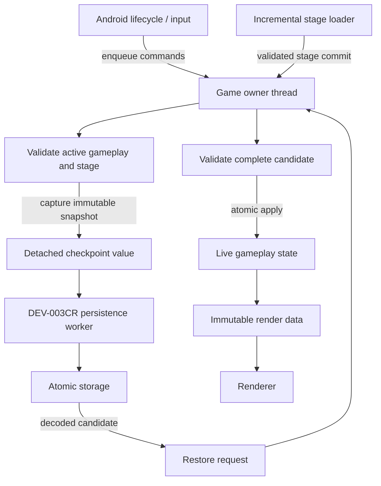

# DEV-003CS-1 — Gameplay State Ownership & Lifecycle Boundary

**Status:** Source-level ownership map documented; Native production owner not yet implemented.  
**Milestone:** Proposed DEV-003CS — Gameplay State Snapshot Model & Provider Foundation.  
**Evidence inputs:** AUDIT-004, AUDIT-009, AUDIT-010, AUDIT-012, DEV-001C.  
**Candidate source revision:** `215c71d04057d66a1b08419b1a4b1043ae3e0881`.

## 1. Finding

The candidate J2ME implementation has a single central game loop in `i.run()`. It calls input handling/update work, dispatches behavior using a global screen/game-flow state, and requests repaint. Active gameplay is identified in the audited state table as global state value 2. The stage-loading path is incremental and is not equivalent to an active, fully initialized gameplay state.

This is evidence about the candidate's architecture, not proof that its thread behavior is safe or a prescription to reproduce its MIDlet threading model. The current Native repository has an Android app shell and a plain-Java `:core` module, but no authoritative Native gameplay simulation owner yet.

## 2. Ownership map

| Domain | Candidate evidence | Native ownership decision | Snapshot treatment |
|---|---|---|---|
| Screen/navigation state | Global state byte selects update and paint paths; state 2 is active gameplay, state 4 menu/title, state 21 incremental preparation, state 22 credits | Owned by an application/game-flow controller, separate from simulation | Never serialize as gameplay checkpoint data |
| Gameplay simulation | Player tile coordinates, movement/action flags, stage layers and per-cell state are mutated by gameplay update paths | One future `:core` simulation owner on a dedicated single-writer game thread/executor | Durable fields only after CS-2 schema audit |
| Input | Candidate key callbacks update a shared key bitmask; gameplay handler consumes it | Android input adapters enqueue immutable actions; only game owner applies them | Do not snapshot held keys or pending input |
| Stage loading | Numbered incremental loading steps read stage layers and initialize resources before gameplay | A loading coordinator prepares temporary stage data; game owner commits only a validated, complete stage | Never capture partially initialized stage |
| Rendering/camera | Paint path reads shared gameplay and screen state; camera coordinates derive from player/stage state | Renderer consumes immutable render data produced by simulation; it does not own gameplay mutation | Exclude render surfaces, camera caches and GPU resources unless later proven durable |
| Animation/audio | Animation indices, timers, animator slots and audio calls participate in transient runtime behavior | Simulation owns deterministic animation state if needed; audio backend owns playback handles | Exclude audio handles and transient playback state; audit animation persistence separately |
| Checkpoint restore | Candidate restore mutates player fields, stage grids, per-cell timers/state, progression fields and rebuild markers | Future restore must validate a detached candidate then apply one atomic command on game owner | Snapshot only evidence-backed data; never mutate from storage/Activity thread |
| Android lifecycle | Candidate MIDlet lifecycle callback branches on global screen state | Android lifecycle sends pause/resume/save-request commands; no direct field access | Lifecycle signal itself is not checkpoint data |
| Persistence I/O | Native DEV-003CR dispatcher/store runs asynchronous I/O and returns callbacks | Persistence worker owns bytes/files only; it never reads or mutates simulation state | Receives detached immutable snapshots only |

## 3. Proposed Native thread contract

The Native implementation should use a single-writer model:

1. **Game owner thread:** sole authority for mutable simulation state, stage commit, snapshot capture, and restore application.
2. **Android main thread:** owns Activity/View lifecycle and UI. It may enqueue commands but must not read mutable simulation fields.
3. **Render consumer:** receives immutable render data. It must not mutate simulation state.
4. **Persistence worker:** encodes/decodes and reads/writes detached checkpoint values. It must not access game objects, grids, renderer objects, or Android Views.

All inbound controls, lifecycle requests, and restore candidates are commands queued to the game owner. Capture is performed by that owner and returns a detached value to the persistence worker. A decoded restore candidate is sent back to the owner for final validation against the active stage/schema and atomic application.

The source audit does not establish that the original MIDlet had a dedicated simulation thread separate from UI callbacks. Therefore this is a Native architecture decision, not a claim about original runtime thread guarantees.

## 4. Capture and restore eligibility

Capture may be requested only when:
- the game owner is initialized;
- a complete stage has been committed;
- the simulation is in a defined checkpoint-safe point (for example, after the movement interpolation/deferred checkpoint capture boundary);
- no stage transition or partial restore is in progress.

Capture must fail explicitly when those conditions are not met. It must not synthesize default coordinates, empty grids, or a placeholder stage.

Restore may be applied only when:
- the candidate has passed codec and schema validation;
- the target stage identity and dimensions are compatible with the active or explicitly loaded stage;
- all required arrays/layers and per-cell state have validated dimensions;
- the game owner can apply the candidate as one transaction.

If validation fails, live state remains unchanged. Resource handles and render caches are reconstructed/rebound after state commit; they are not deserialized.

## 5. Important checkpoint distinction

AUDIT-009 records that the candidate's `saveCheckpoint()` and `restoreCheckpoint()` manage a full in-memory respawn snapshot held in static arrays and instance fields. The inspected methods do not serialize that complete snapshot to RMS. It is not evidence of a durable app-restart save format.

The Native DEV-003CR checkpoint persistence boundary is a separate system. DEV-003CS must define the intersection between durable checkpoint data and the actual Native simulation model; it must not assume that the old in-memory arrays are already a complete durable schema.

## 6. Ownership and lifecycle flow

## 7. Unresolved questions carried to CS-2

- Exact complete durable field list and schema version are not yet established.
- Exact semantic names and invariants for several decompiled counters/flags remain unresolved.
- Which animation/movement phase fields are necessary to resume deterministically requires further audit; default policy is to exclude transient animation state.
- Stage identity, world identity, progression compatibility and per-cell array bounds need an explicit schema matrix.
- The Android app currently has no production game-owner thread or gameplay state model; this document defines the boundary, not implemented code.

## 8. CS-1 exit assessment

**Completed:** source-level separation of screen/navigation, simulation, input, stage loading, rendering, lifecycle, checkpoint restore, and persistence responsibilities; proposed Native single-writer thread contract; capture/restore eligibility rules; Mermaid ownership flow.

**Not completed:** actual Native owner implementation, schema field matrix, provider implementation, runtime validation, or physical-device testing.

CS-1 can be considered complete as an architecture/evidence document. CS-2 is the next safe step. No production provider code should be written until the persisted-field matrix is reviewed and the minimal Native gameplay state owner is implemented in the appropriate DEV-002 workstream.
